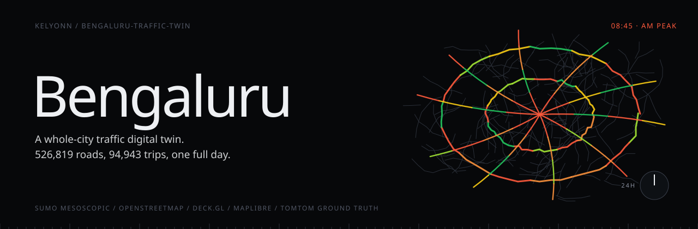
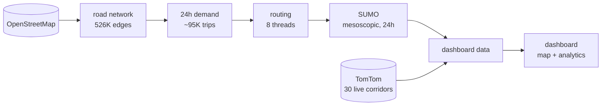

<p align="center">
  
</p>

<p align="center">
  <b>A whole city, simulated for a whole day.</b><br>
  <sub>A traffic digital twin of Bengaluru built on SUMO and real OpenStreetMap infrastructure: every road, every signal, 95 suburbs, and about 95,000 trips shaped like the city's actual commute.</sub>
</p>

<p align="center">
  <sub>
    <a href="#overview">OVERVIEW</a> &nbsp;·&nbsp;
    <a href="#quick-start">QUICK START</a> &nbsp;·&nbsp;
    <a href="#whats-real-and-whats-simulated">REAL VS SIMULATED</a> &nbsp;·&nbsp;
    <a href="#the-day">THE DAY</a> &nbsp;·&nbsp;
    <a href="#the-pipeline">THE PIPELINE</a> &nbsp;·&nbsp;
    <a href="#the-dashboard">THE DASHBOARD</a> &nbsp;·&nbsp;
    <a href="#build-it">BUILD IT</a>
  </sub>
</p>

<br>

<table>
  <tr>
    <td><sub>ROAD SEGMENTS</sub><br><b>526,819</b></td>
    <td><sub>TRAFFIC SIGNALS</sub><br><b>1,377</b></td>
    <td><sub>SUBURBS</sub><br><b>95</b></td>
    <td><sub>TRIPS IN 24H</sub><br><b>94,943</b></td>
    <td><sub>INTERVALS</sub><br><b>288 × 5 min</b></td>
    <td><sub>BUILD</sub><br><b>~40 min</b></td>
  </tr>
</table>

## Overview

A digital twin of Bengaluru's roads. The infrastructure is real, from OpenStreetMap: every road segment, every traffic signal, 95 named suburbs. The traffic is simulated: about 95,000 trips across a full day, shaped like the city's actual commute from homes to the IT corridors and back.

The result is a dashboard where you can watch the whole day unfold on a map, and break it down by hour and by area.

> [!NOTE]
> The roads, signals, suburbs and the shape of demand are real. The vehicles and their congestion are simulated, and the TomTom corridors are there to keep the simulation honest.

## Quick start

```bash
cd full-city
bash run_24h.sh                 # the whole pipeline, about 40 minutes
python3 -m http.server 8888     # open /dashboard.html
```

## Pipeline at a glance




## What's real and what's simulated

Being clear about this is the point of a twin.

| Layer | Source | Real or simulated |
|---|---|---|
| Road network | OpenStreetMap via Geofabrik | **Real.** 526,819 edges with lane counts, speed limits and junction topology. |
| Traffic signals | OSM `highway=traffic_signals` | **Real.** 1,377 signal nodes. |
| Suburbs | OSM `place=suburb` | **Real.** 95 named areas, Koramangala to Whitefield. |
| Live reference | TomTom Traffic Flow API | **Real.** 30 corridors: current speed, free-flow speed, congestion. |
| Demand | Residential origins weighted toward IT-corridor destinations | **Modelled** on the city's commute geography |
| Vehicle flow | SUMO mesoscopic simulation | **Simulated.** Speed, density and occupancy per road, every 5 minutes. |

The roads, signals, areas and the shape of demand are real. The vehicles and their congestion are simulated.

## The day

Demand follows Bengaluru's commute: residential zones in the morning, toward Electronic City, Whitefield, Manyata Tech Park and the Outer Ring Road belt, and back again in the evening.

| Window | Time | Character |
|---|---|---|
| Deep night | 00:00–05:00 | Near empty |
| Morning ramp | 05:00–07:00 | Building |
| **AM peak** | **07:00–10:00** | **Residential to IT corridors, a trip every 0.3 s** |
| Midday | 10:00–13:00 | Steady |
| Afternoon | 13:00–17:00 | Moderate |
| **PM peak** | **17:00–21:00** | **The return commute, a trip every 0.35 s** |
| Wind-down | 21:00–24:00 | Tapering |

The simulation is **mesoscopic**: queue-based flow on every edge rather than car-following physics for every vehicle. It is the standard choice for network-scale studies, and it is what lets a full city day run in about 13 minutes.

## The pipeline

```
OpenStreetMap (Geofabrik)
  └─ osmium clip                → bengaluru.osm.pbf
      └─ netconvert             → bengaluru.net.xml        526K edges
          ├─ generate_weights   → spatial demand weights
          ├─ generate_demand    → ~95K trips over a 24h curve     ~15 min
          ├─ duarouter          → routes, contraction hierarchies, 8 threads   ~5 min
          └─ sumo --mesosim     → edge data + vehicle traces      ~13 min
              ├─ build_light_outputs → dashboard JSON              ~15 min
              ├─ simplify_roads      → Douglas–Peucker geometry
              ├─ build_analytics     → daily, area, peak, speed distributions
              └─ fetch_tomtom        → 30 live corridors
dashboard.html  ←  reads every artifact
```

## The dashboard

One static page, two views.

**Live map** (deck.gl on MapLibre). Roads coloured by speed relative to free flow, animated vehicle trails, a density heat map, and the TomTom corridors as ground truth. It interpolates smoothly between five-minute intervals, with play, pause, step, 0.5× to 8× speed, and a 24-hour scrubber.

**Analytics** (ECharts). Peak active roads, city-wide average speed, the most congested area, morning rush against evening rush, a 24-hour congestion breakdown from free to jammed, the speed distribution, the 30 most congested suburbs, and a drill-down into any one of them.

## Build it

SUMO 1.20+ with `SUMO_HOME` set, `osmium-tool`, Python 3.9+, and optionally a free TomTom key for the live overlay.

```bash
brew install sumo osmium-tool                       # macOS; on Ubuntu use the sumo/stable PPA
export SUMO_HOME=/opt/homebrew/opt/sumo/share/sumo
export TOMTOM_API_KEY=your_key                      # optional
cd full-city
bash run_24h.sh                                     # about 40 minutes
python3 -m http.server 8888                         # then open /dashboard.html
```

On Windows, use WSL2 and the Ubuntu steps.

<details>
<summary><b>Repository layout</b></summary>
<br>

```
full-city/
  dashboard.html          the two-view dashboard
  run_24h.sh              the whole pipeline, one command
  generate_weights.py     residential → IT corridor demand weights
  generate_demand.py      the 24h trip curve, nine time windows
  bengaluru.sumocfg       simulation config
  build_light_outputs.py  traces and edge data → dashboard JSON
  simplify_roads.py       geometry reduction
  build_analytics.py      the analytics aggregates
  fetch_tomtom.py         live corridor snapshot
  osm_suburbs.geojson     95 suburbs
  osm_signals.geojson     1,377 signals
  tomtom_flow.json        a committed TomTom snapshot
```

</details>

<sub>MIT.</sub>
